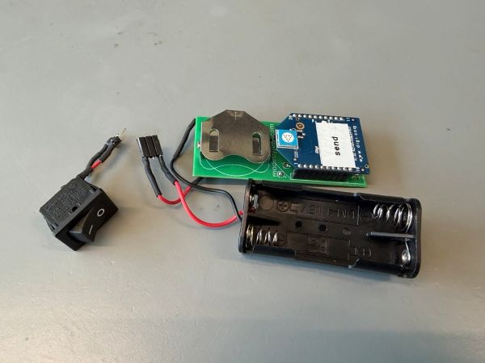
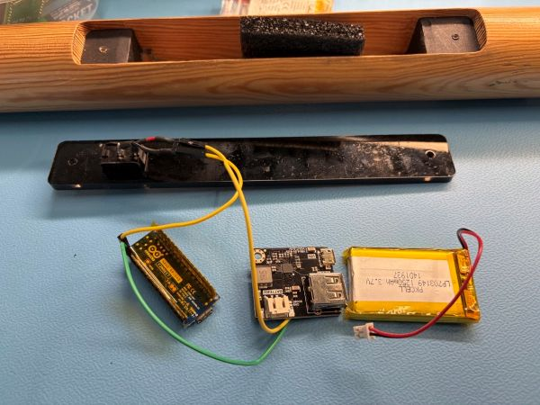
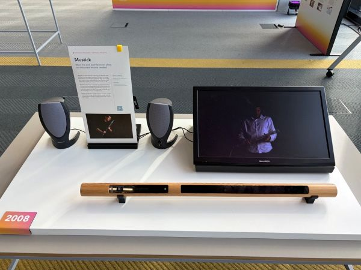

# Mustick - BLE Interactive Music Stick

A modern re-implementation of an old project in 2008, "Mustick", for the 25 years Expo of Industrial Design department of TU/e.

Check here: [Demo video in 2009](https://www.youtube.com/watch?v=_1Nzi_DDHGM)

Originally, the prototype uses xBee modules for data transmittion, but I have to figure out some other way to transfer data wirelessly since I have only the sender side module, and the data is not something readable (at least not for me).

<br />
**Figure 1** - The original sender side with xBee module.

So, I tried to impliment the idea with BLE.

The mustick reads motion data from an IMU sensor on an Arduino Nano RP2040 Connect, broadcasts motion intensity over Bluetooth Low Energy (BLE) to a Python bridge script on a Raspberry Pi, and dynamically modulates music playback speed in Processing via internal OSC messages. When movement stops, playback smoothly ramps down and pauses.

<br />
**Figure 2** - The rebuilt prototype setup.

This rebuilt prototype is demostrated in the ID25 Expo of TU/e in Oct.17, 2026 - Oct. 25, 2026.

<br />
**Figure 3** - The demo in 25ID Expo.

<br />

## Preparation

### Hardware Requirements

1. **Arduino Nano RP2040 Connect** (with onboard LSM6DSOX IMU & BLE)
2. **Seeed Studio LiPo Rider Plus** & **LiPo Battery** (for portable power)
3. **Raspberry Pi 4** (running Raspberry Pi OS)
4. **Audio DAC Shield** (External DAC shield for Raspberry Pi to ensure smooth, low-latency hardware audio decoding)
5. Speaker or headphones connected to the audio DAC shield

### Software & Environment

1. **Arduino IDE 2.3.10+** (with Mbed OS Nano board support package)
2. **Python 3.12+**
3. **Processing 4**
4. An audio file formatted as `.wav` named `song.wav` by default

<br />

## Architecture Overview

[ Arduino Nano RP2040 Connect ] │ LSM6DSOX IMU motion detection

▼ BLE Notification (Device Name: "Mustick")

[ Python BLE Bridge (ble_bridge_comments.py) ] │ Runs on Raspberry Pi / Localhost

▼ OSC Protocol (UDP Port 12000, Address: "/accel")

[ Processing (song.wav + Minim Sound Engine) ] │ Runs on Raspberry Pi / Localhost

▼ Dynamic Playback Speed (0.0x ~ 1.0x)

Audio Output via DAC Shield

<br />

## Setup & Installation

### 1. Arduino Firmware Setup

1. Open the Arduino sketch in Arduino IDE.
2. Install the required libraries via the Arduino Library Manager:
   - `Arduino_LSM6DSOX`
   - `ArduinoBLE`
   - `floatToString`
3. Configure your UUID credentials in `secrets.h`:

   ```cpp | title=secrets.h
   #define TARGET_NAME "Mustick"
   #define SERVICE_UUID "4fafc201-1fb5-459e-8fcc-c5c9c331914b"
   #define CHARACTERISTIC_UUID "beb5483e-36e1-4688-b7f5-ea07361b26a8"
   ```

   Connect the Arduino Nano RP2040 Connect, select the proper COM port, and upload the code.

### 2. Python BLE Bridge Setup

1. Open terminal on your host machine or Raspberry Pi

2. Install the required Python libraries:

   ```Bash
   > pip install bleak python-osc
   ```

3. Verify that the device name (Mustick) and CHARACTERISTIC_UUID match those defined in `secrets.h`.

### 3. Processing Environment Setup

1. Open Processing and install the following libraries via Sketch

   [Import Library] -> [Manage Libraries] -> Search and install
   - `Minim` (by Damien Di Fede and Anderson Mills)

   - `oscP5` (by Andreas Schlegel)

2. Place your audio track named `song.wav` into the `data` folder inside the Processing sketch directory.

3. If running on Raspberry Pi OS, verify that the Java Sound System properties point to the hardware Direct Audio Device:

   ```Java
   // These two lines will make the Processing on Pi OS output audio data via the DAC shield
   System.setProperty("javax.sound.sampled.Clip", "com.sun.media.sound.DirectAudioDeviceProvider");
   System.setProperty("javax.sound.sampled.SourceDataLine", "com.sun.media.sound.DirectAudioDeviceProvider");
   ```

<br />

## Usage

### Start it up

1. Launch Processing on RPi 4: Run the Processing sketch.

2. Start the Python Bridge on RPi 4:

   ```Bash
   python ble_bridge_comments.py
   ```

The script will scan for "Mustick", establish the BLE connection, and forward incoming accelerometer data to 127.0.0.1:12000.

1. Power up the Mustick: Turn on the Arduino Nano RP2040 Connect powered by the LiPo Rider Plus battery. The board will begin advertising as "Mustick".

### Interact

- Shake or swing the device: Processing transitions to the MOVING state (green display) and scales the music playback speed up to 1.0x (general speed).

- Keep the device stationary: Processing transitions to the STILL state (red display) and smoothly decelerates playback to 0x (paused).

<br />

## Project Owner

Tom van Bergen

Wouter Kersteman

Floor Mattheijssen

Joris Zaalberg

<br />

## Project Partners

Kees Overbeeke (lecturer)

Stephan Wensveen (lecturer)

<br />

## Re-Creater @ 2026

I-Tang (Eden) Chiang @ /d.Search-Lab of Industrial Design department, TU/e
